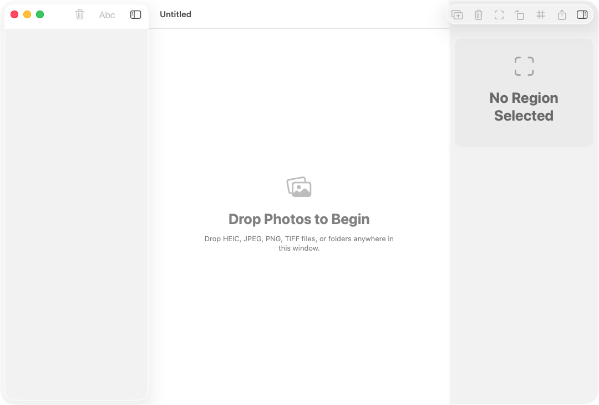
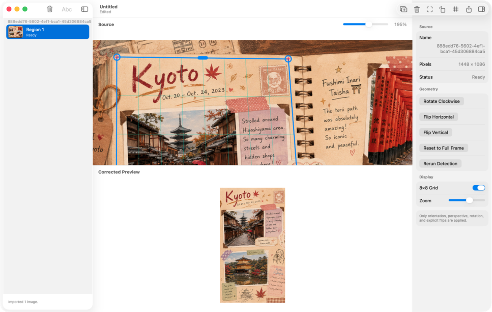
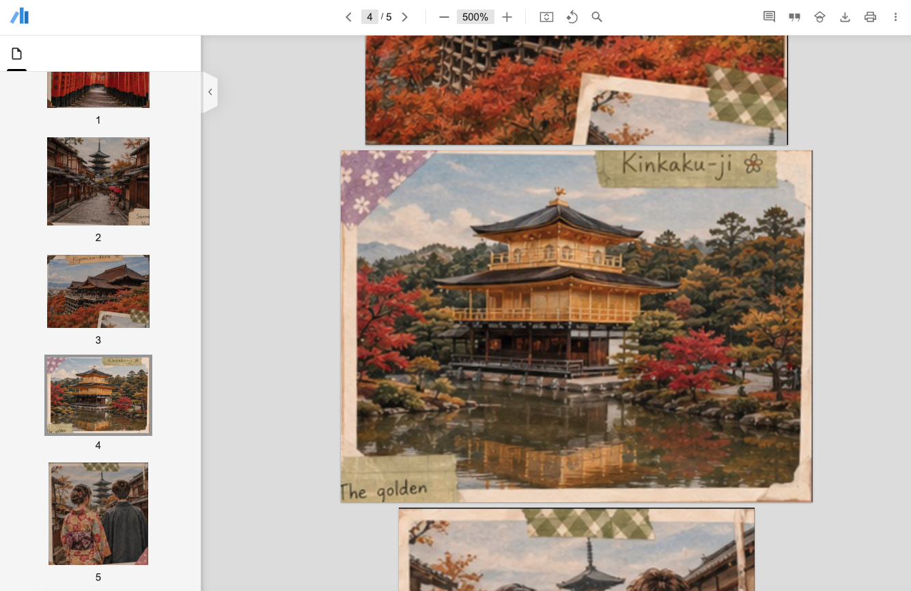

<table>
  <thead>
    <tr>
      <th style="text-align:center"><a href="README_ja.md">日本語</a></th>
      <th style="text-align:center"><a href="README.md">English</a></th>
    </tr>
  </thead>
</table>

# ScanPhotoEditor

ScanPhotoEditor は、スマートフォンで撮影した画像から印刷写真を個別に切り出すための、オフライン動作の macOS ドキュメントアプリです。複数の写真を自動検出し、遠近補正を行い、精密な手動ジオメトリ操作を提供し、自動画像補正を適用せずにフル解像度の画像または順序付きPDFをエクスポートします。

## スクリーンショット

<table>
  <tr>
    <td align="center">
      <br>
      <sub>画像ファイルまたはフォルダを新しいプロジェクトにドロップします。</sub>
    </td>
    <td align="center">
      <br>
      <sub>補正結果を確認しながら検出されたコーナーを調整します。</sub>
    </td>
    <td align="center">
      <br>
      <sub>補正済み領域を順序付きの複数ページPDFとしてエクスポートします。</sub>
    </td>
  </tr>
</table>

## 機能

- ドラッグ＆ドロップしたファイルまたはフォルダから HEIC/HEIF、JPEG、PNG、TIFF ファイルを再帰的にインポートします。
- Apple Vision を使用して各ソース画像内の複数の矩形写真を検出します。
- ドラッグ可能なコーナーおよびエッジハンドル、オプションの 8×8 グリッド、ズーム可能なソースプレビューを提供します。
- 手動領域の追加、検出の再実行、フルフレームリセット、90度回転、水平・垂直反転をサポートします。
- ジオメトリの編集、領域の作成・削除、ソースの削除、並び順の変更をすべて取り消し可能にします。
- ドラッグ＆ドロップでソースと領域を並べ替えたり、自然数値順でファイル名によりソース画像をソートしたりできます。
- コピーしたオリジナル、サムネイル、ジオメトリ、エクスポート順を移植可能な `.scanphoto` パッケージに保存します。
- すべての領域または選択した領域を JPEG、HEIC、PNG、TIFF、および/または順序付きの複数ページPDFとしてエクスポートします。
- JPEG、HEIC、PDF それぞれの品質設定、エクスポート進捗状況、キャンセル、失敗の報告、競合回避ファイル名を提供します。
- クラウドへのアップロードやサードパーティのランタイム依存なしに、ローカルで写真を処理します。

## 画像保全ポリシー

レンダリングパイプラインは意図的にジオメトリのみに限定されています：

1. EXIF 方向の正規化
2. 遠近補正
3. 明示的な90度回転
4. 明示的な水平または垂直反転
5. エンコーダーが必要とするカラープロファイル処理

ScanPhotoEditor は、自動露出・ホワイトバランス・コントラスト・彩度・シャープニング・ノイズ除去・復元・OCR・顔分析を一切適用しません。インポートされたオリジナルはプロジェクトパッケージにコピーされ、変更されることはありません。

## 動作環境

- Apple Silicon Mac
- macOS 26.0 以降
- Xcode 26.5 以降
- Xcode プロジェクトを再生成する場合は XcodeGen 2.45.4

## ビルドと実行

チェックイン済みの `ScanPhotoEditor.xcodeproj` がメインプロジェクトです。Xcode で開いて `ScanPhotoEditor` スキームを実行するか、ターミナルからビルドして起動します：

```sh
./script/build_and_run.sh
```

`project.yml` を変更した後にプロジェクトを再生成するには：

```sh
xcodegen generate
```

ビルドスクリプトは `--debug`、`--logs`、`--telemetry`、`--verify` もサポートしています。

## 使い方

1. 新しいドキュメントを作成するか、既存の `.scanphoto` プロジェクトを開きます。
2. サポートされている画像ファイルまたはフォルダをドキュメントウィンドウのどこにでもドロップします。
3. サイドバーで検出された領域を選択します。
4. コーナーまたはエッジハンドルをドラッグしてトリミングを調整します。グリッドと補正済みプレビューを使って整列を確認します。
5. 必要に応じて回転、反転、追加、削除、リセット、並べ替え、再検出を行います。
6. ドキュメントを保存して、コピーされたオリジナルと非破壊編集を保持します。
7. **ファイル → エクスポート…** を選択し、出力形式と領域を選んで、保存先フォルダを指定します。

矩形が検出されなかった場合、アプリは手動で修正できるように **要確認** とマークされたフルフレーム領域を作成します。

## プロジェクト形式

`.scanphoto` ドキュメントは、プロジェクトマニフェスト、コピーされたオリジナルファイル、生成されたサムネイルを含むパッケージです：

```text
Example.scanphoto/
├── manifest.json
├── Originals/
└── Thumbnails/
```

編集にはプレビューサイズの画像を使用します。フル解像度のオリジナルはエクスポート時にのみデコードされ、PDFページはメモリ使用量を抑えるために1ページずつレンダリングされます。

## 開発

このアプリは以下を使用しています：

- SwiftUI：ドキュメントインターフェース、エディタ、インスペクタ、設定、エクスポートワークフロー
- Vision：矩形検出
- Core Image：遠近補正
- ImageIO：画像のデコードとエンコード
- Core Graphics：ストリーム形式のPDF生成
- `ReferenceFileDocument` と `FileWrapper`：`.scanphoto` パッケージ
- XCTest と XCUITest：自動テストカバレッジ

テストスイートの実行：

```sh
xcodebuild \
  -project ScanPhotoEditor.xcodeproj \
  -scheme ScanPhotoEditor \
  -destination 'platform=macOS,arch=arm64' \
  test
```

## ライセンス

ScanPhotoEditor は [MIT ライセンス](LICENSE) のもとで利用可能です。
